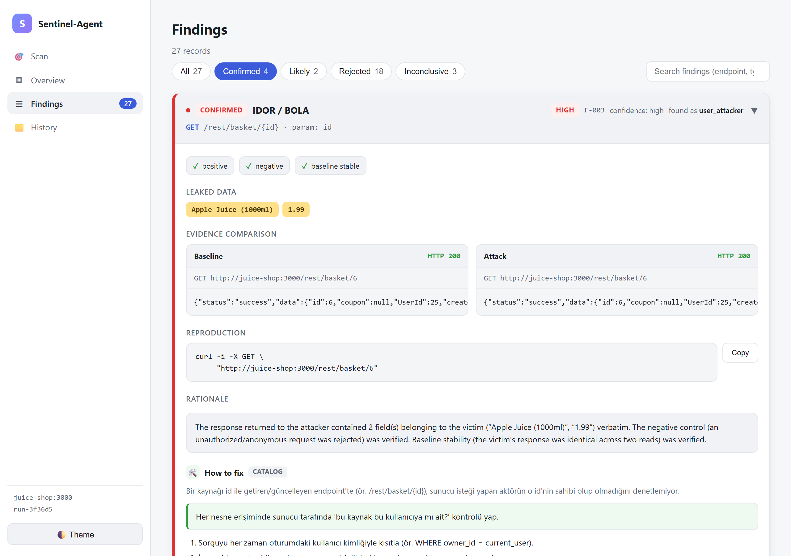
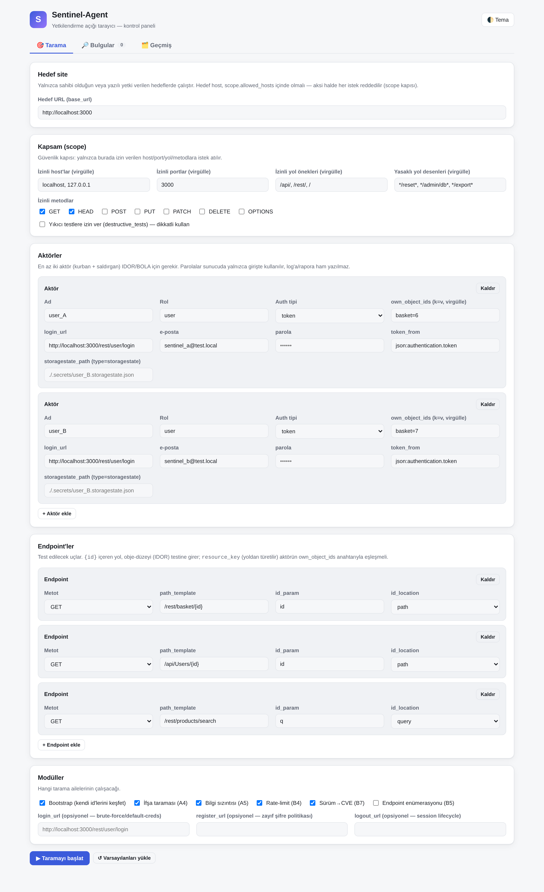

<div align="center">

# 🛡️ Sentinel-Agent

**Evidence-based access-control pentesting — an AI agent that has to prove it.**

_The LLM reasons. A deterministic engine decides._

[](https://www.python.org/)
[](docker-compose.yml)
[-9775fa.svg)](#-the-control-panel)
[](https://owasp.org/API-Security/editions/2023/en/0xa1-broken-object-level-authorization/)
[](LICENSE)

</div>

---

## Try it

**Zero install — just look at the output.** Download
[`docs/sample-report.html`](docs/sample-report.html) and open it in a browser: a real, redacted
report from an actual scan against OWASP Juice Shop (4 `CONFIRMED` findings, evidence and all). No
server, no build step, just a double-click.

**Run the whole thing yourself** (needs Docker Compose):

```bash
make demo
```

That boots a deliberately vulnerable target, creates two real user accounts, runs the scan and
writes a report you can open in a browser. Then explore the findings in the control panel:

```bash
python -m scripts.serve_ui        # → http://127.0.0.1:8787
```

<div align="center">



<sub>A finding in the control panel: the three verification controls, the baseline↔attack response
diff with the leaked marker highlighted, a copy-paste repro <code>curl</code>, and step-by-step
remediation.</sub>

</div>

---

## What it does

Sentinel-Agent finds **broken authorization** in web apps and APIs — IDOR/BOLA, BFLA, excessive
data exposure, unauthorized writes and deletes — plus a range of classic web vulnerabilities. It
logs in as **two real users**, then measures whether one can reach the other's data.

A finding is only marked `CONFIRMED` when the victim's *own private data* is provably present in
the attacker's response. That decision is made by code, never by a language model.

### An access-control *and* agent-security scanner for the AI era

The same engine now covers a second kind of target: **AI agents and their MCP tools**. As
applications hand real authority to LLM agents, a new class of authorization bug appears that no
URL-replay scanner looks for — an agent, carrying the user's privileges, is tricked into acting
against them. Sentinel analyzes an agent's **observed tool-call trace** (collected from MCP logs or
an SDK, offline — the LLM never touches the network) with the *same* deterministic, 0-false-positive
discipline, and proves agent-security predicates such as:

- **confused deputy** — a side-effecting call (`email.send`) with no user intent behind it;
- **exfiltration** — a planted canary secret leaving in an outbound call, even base64-encoded;
- **untrusted-to-action** — attacker-controlled content (a web/email result) driving a privileged action;
- **memory poisoning** — untrusted content written to persistent memory, then re-read a turn later to trigger an action;
- **insecure output handling** — a tool's output flowing unsanitized into `shell.exec`/`sql.query`;
- **excessive agency** — a destructive call whose blast radius (`rm /drafts/*`, `DELETE … ` with no `WHERE`) exceeds what the user authorized;
- plus **destructive write** and **manifest deviation** (an agent stepping outside its own declared tool set).

The product is deliberately **four arms on one spine**: **(A)** access control — the crown jewel;
**(B)** classic injection/web and **(C)** infrastructure/config — commodity, complementary coverage;
and **(D)** agent/LLM/MCP security — the flagship differentiator. Every type in A and D, and the
commodity types proven so far, is backed by a vulnerable↔hardened **eval twin** that runs the real
oracle network-free in CI (0-FP gate). Because *the LLM reasons, the engine proves*, the whole thing
runs **on-prem against a local model** — a strong argument for finance/defense/health teams who will
not send traffic or vulnerability data to a cloud LLM.

### Why this matters to people who will never read this README

Broken Object Level Authorization has been **#1 on the OWASP API Security Top 10** for years, and
it is the single most boring bug in security: a URL ends in `/orders/1043`, someone types `1044`,
and they are reading a stranger's order. No exploit, no malware — just a number.

In 2019 the title insurance company **First American Financial** exposed roughly **885 million**
documents this way: mortgage paperwork, bank account numbers, wire transfer receipts, Social
Security numbers and driver's licenses, reachable by editing a document ID in a link. Nobody had to
break in. The records of ordinary people buying a house were simply *addressable*.

That is what this tool hunts. Not a theoretical class of bug — the specific path by which a normal
person's orders, medical records and messages end up in someone else's browser.

### What's actually new here

Differential authorization testing is **not** new. [Burp Suite's Autorize extension][autorize] and
[AuthMatrix][authmatrix] have replayed one user's requests as another for years, and the academic
[AuthProbe][authprobe] work is where this project's benchmark methodology comes from. If you want a
mature, general-purpose tool today, use those.

Three things here are ours:

1. **Verdicts come from deterministic evidence, not from a model.** `CONFIRMED` requires a
   *leaked marker* — a value belonging to the victim, provably absent from what the attacker is
   legitimately allowed to see. Uncertainty is reported as `INCONCLUSIVE` rather than smoothed over.
2. **Tamper-evident proof bundles.** Every confirmed finding ships as a portable bundle sealed with
   a SHA-256 integrity hash (optionally HMAC-signed), re-provable offline with no network and no
   model. Hand it to a security team; they can verify you didn't edit it.
3. **An evidence engine other agents can call.** Over [MCP](https://modelcontextprotocol.io),
   another AI agent can stop guessing and ask Sentinel to *prove* a suspicion instead.

[autorize]: https://github.com/PortSwigger/autorize
[authmatrix]: https://github.com/SecurityInnovation/AuthMatrix
[authprobe]: https://arxiv.org/html/2607.20574v1

---

## The verdict ladder

Uncertainty is reported, never hidden:

| Verdict | Meaning |
|---|---|
| ✅ **CONFIRMED** | Proven. The victim's private data appeared in the attacker's response, or a write/delete persisted on the victim's object. |
| 🟡 **LIKELY** | Strong signal, but no deterministic leaked marker. |
| ⛔ **REJECTED** | Authorization works. No vulnerability here. |
| ❔ **INCONCLUSIVE** | Controls failed or the oracle couldn't be sure. It abstains instead of guessing. |

> **This is the point of the project.** An oracle saying "I could not be sure" is not a gap — it is
> the reason the `CONFIRMED` list can be trusted. There is deliberately **no fallback** that
> downgrades an uncertain result into a softer "probably".

### Security invariants (non-negotiable)

| # | Invariant |
|---|---|
| 1 | **The LLM never touches the network.** It proposes typed actions; all traffic goes through one `Replayer`. |
| 2 | **Code decides `CONFIRMED`,** never the LLM — and only on a deterministic leaked marker. |
| 3 | **Two actors never share a session or cookie** — enforced by a cross-contamination test. |
| 4 | **No verdict without controls** — positive, negative and baseline-stability must all pass. |
| 5 | **Scope gate on every request** — allowlist + IP pinning. The LLM's suggestions are not trusted. |
| 6 | **Redaction is mandatory** — tokens, cookies and PII never reach logs, evidence, reports or the UI in raw form. |

---

## 🖥️ The control panel

The panel is the front door; the CLI is underneath it. The server is written against the Python
**standard library** — no extra dependencies — and binds to `127.0.0.1` only.

```bash
python -m scripts.serve_ui                    # → http://127.0.0.1:8787
python -m scripts.serve_ui --port 9000 --out runs/
```

| View | What it does |
|---|---|
| 🎯 **Scan** | Enter target, scope, actors and endpoints in a form; watch the scan run live |
| 🔎 **Findings** | Verdict counters, filter and search; per finding: the evidence, the response diff, the repro curl, and how to fix it |
| 🗂️ **History** | Reopen any previous run from `runs/` with the same detail |

<div align="center">



</div>

**How the panel is kept safe.** It locks scope to a file on disk (default `config/scope.yaml`), not
to whatever the form posts — a submitted scope can only *narrow* it, never widen it. Every request
still passes `PolicyEngine`. A `RequestGuard` rejects unknown `Host` headers (DNS rebinding) and
non-JSON `POST` bodies (CSRF). Passwords are used to log in and never written to logs, reports or
the UI. Binding to `0.0.0.0` requires an explicit `--allowed-host`, or nothing is served at all.

---

## Running it against your own target

What the tool needs is not a swarm of agents — it is **two real accounts**: a victim and an
attacker. (An optional `admin` enables BFLA testing.)

```bash
# 1) scope: host/port/path/method allowlist for the target
cp config/scope.example.yaml     config/scope.yaml

# 2) actors: at least 2 accounts (token | storagestate | static | browser auth)
cp config/actors.example.yaml    config/actors.yaml

# 3) endpoints: list them, or discover with --openapi / --har
cp config/endpoints.example.yaml config/endpoints.yaml

# 4) scan (LLM optional — off by default)
python -m scripts.run_scan \
    --scope config/scope.yaml --actors config/actors.yaml \
    --endpoints config/endpoints.yaml --mode active --out runs/
```

> 💡 Start with `--dry-run`: it shows which requests the policy would ALLOW or DENY without sending
> a single one.

Installed as a CLI (`pip install .`), the same scan is `sentinel scan ...`, and
`--scan-mode quick|standard|deep` scales the budget and breadth.

### Envanter + fark (Faz 5)

Aynı hedefi her gece **aynı** SQLite dosyasıyla tarayın: envanter, uçları, rol→status profilini ve
yanıt şeklini (yalnızca alan adı + tip) koşumlar arasında saklar.

```bash
python -m scripts.run_scan ... --inventory runs/inv.sqlite           # ilk koşum: tüm uçlar
python -m scripts.run_scan ... --inventory runs/inv.sqlite --delta   # sonraki koşumlar: fark
```

`--delta` yalnızca yeni/değişen/bayat uçları test eder (ilk koşumda yine tümü test edilir);
`--inventory` verilmezse envanter kapalıdır ve mevcut davranış değişmez. Her koşumda
`report.md` / `report.html` dosyasının **en üstünde** bir envanter bloğu ve ayrı bir
`inventory_diff.json` artefaktı üretilir — temiz taramada da üretilir.

| Kategori | Anlamı |
|---|---|
| `new` | Bu koşumda ilk kez görülen uç |
| `changed` | Parametre kümesi değişen uç |
| `auth_changed` | Bir rolün yanıt status kodu değişen uç |
| `shape_changed` | Yanıt alanları/tipleri değişen uç |
| `missing` | Bu koşumda görülmeyen uç (3. kez emekli sayılır) |
| `returned` | Kaybolan/kaldırılan uç yeniden görüldü |
| `stale` | ≥14 gündür test edilmeyen uç |

> **Yetki değişimi bir UYARIDIR, kanıt değildir.** `auth_changed` satırı raporda açıkça
> "UYARI, kanıt değil" der; `CONFIRMED` kararını yalnızca deterministik oracle'lar verir.
> SQLite dosyası yerelde kalır; token, cookie, PII veya ham yanıt **DEĞERİ** yazılmaz — yalnızca
> şablon yol, alan adları, status kodları ve verdict'ler saklanır.

**Authentication types** (`config/actors.yaml` → `auth.type`):

| Type | When | How |
|---|---|---|
| `token` | Simple login (one `POST` → token in JSON) | `login_url` + `credentials` + `token_location` |
| `static` | You already hold a token/cookie | `headers` / `cookies` directly |
| `storagestate` | SPA/OAuth login — log in manually, export with Playwright | `storagestate_path` (under `.secrets/`) |
| `browser` | SPA/OAuth login + **TOTP MFA** — automates the export step | `login_url` + `credentials` + optional `mfa_totp_secret` |

`browser` only solves **TOTP** MFA; SMS/push are not supported and it fails loudly rather than
producing a silently wrong session.

<details>
<summary><b>Full CLI reference</b></summary>

| Flag | Description |
|---|---|
| `--scope / --actors / --endpoints` | config YAML files (scope + actors required) |
| `--openapi <spec>` / `--har <file>` | discover endpoints from an OpenAPI spec or a browser HAR export |
| `--mode passive\|active` | `passive`: list only · `active`: run the differential test |
| `--scan-mode quick\|standard\|deep` | scales budget + breadth (`quick`≈40 requests/300s) |
| `--inventory <db.sqlite>` | Faz 5: kalıcı envanter (ör. her gece aynı `runs/inv.sqlite`) |
| `--delta` | Faz 5: yalnız yeni/değişen/bayat uçlar (`--inventory` zorunlu) |
| `--dry-run` | authorize requests but **don't send** them |
| `--enumerate` | wordlist endpoint enumeration + GraphQL introspection |
| `--login-url / --register-url / --logout-url` | enables brute-force, weak-password and session-lifecycle checks |
| `--no-exposure-scan / --no-info-leak-scan / --no-rate-limit-scan / --no-cve-scan` | skip a detector family |
| `--loop` | self-improving orchestrator: pivot new hypotheses off a CONFIRMED finding |
| `--agent [--scouts N]` | agentic reasoning loop; parallel scouts share one budget and policy |
| `--llm none\|gemini\|ollama\|anthropic` | hypothesis/triage LLM (default `none`) |
| `--llm-config <file>` / `--llm-model <name>` | LLM settings from a file; CLI flags override it |
| `--enrich` | add severity/impact/remediation prose via LLM (verdict never changes) |
| `--fail-on none\|low\|medium\|high\|critical` | CI gate: exit code 2 at or above this severity |
| `--baseline <previous-findings.json>` | exempt known findings from `--fail-on`; they stay in the report |

</details>

### The LLM is optional — and off by default

Hypotheses are generated from deterministic rules: id-shaped path segments, parameter types read
from OpenAPI/HAR, an id pool learned during an authenticated crawl, and marker candidates inferred
from the response shape. With `--llm none` the tool still produces proven `CONFIRMED` findings. An
LLM only widens coverage and improves the prose.

Local models are supported through Ollama, so target data never leaves the machine:

```bash
ollama pull qwen3.8:27b
python -m scripts.run_scan ... --llm ollama --llm-model qwen3.8:27b --enrich
```

Hypothesis, enrichment and action selection are constrained to a JSON **schema**; anything
off-schema is dropped rather than crashing the scan. `temperature` defaults to `0`.

> **Full AI-usage disclosure** — which AI tools are used at build time and at run time, and the
> hard limits on what the LLM may do: **[docs/AI_DISCLOSURE.md](docs/AI_DISCLOSURE.md)**.

---

## 📐 Does it actually work?

A claim like "proven, deterministic, low false-positive" is worthless unless it is measured
against **labelled ground truth**. Labels are set by observing the target's real HTTP behaviour,
never by reading the tool's own output — otherwise the measurement is circular.

**Three targets, 32 labelled cases.** All three were re-run on 2026-11-26 **rule-only**
(`--llm none`, so no target data goes to any model):

| Target | Stack | Cases | Precision | Recall | FP-rate | TP/FN/FP/TN |
|---|---|---|---|---|---|---|
| OWASP Juice Shop | Node/Express | 8 (4 pos / 4 neg) | **100%** | **100%** | **0%** | 4/0/0/4 |
| VAmPI | Python/Flask | 12 (4 pos / 8 neg) | **100%** | **100%** | **0%** | 4/0/0/8 |
| OWASP crAPI | Java/Python/Go microservices | 12 (5 pos / 7 neg) | **100%** | **100%** | **0%** | 5/0/0/7 |

VAmPI and crAPI went from 50% / 40% recall to 100% after fixes made *while looking at their
misses* — so these are calibrated numbers, not a generalization claim (see the notes below).

**Without a hand-given endpoint list the picture is very different.** The numbers above are
measured with the endpoint list supplied. The Faz 0 baseline (2026-11-26, URL-only, automatic
discovery only — [`benchmarks/kesif.result.md`](benchmarks/kesif.result.md)) found 15% of VAmPI's
endpoints and 0% of crAPI's and Juice Shop's, so end-to-end vulnerability recall was **0%** on all
three. After Faz 1 (eight discovery sources, 2026-11-27, same URL-only method, no endpoint list):
discovery recall is **100%** on VAmPI (end-to-end recall 50%), and **72.7%** on crAPI and **33.3%** on
Juice Shop when the scope allows the site root (end-to-end recall 40% / 0%; 0 false positives
throughout); with crAPI's path-prefix-restricted scope the root and its JS bundle are out of scope
and recall stays at 0%. A follow-up fix (response-template comparison, parameter-route and SPA-shell
rejection, discovery request cap) cut the raw false-endpoint rate to 7.1% (VAmPI), 27.3% (crAPI) and
16.4% (Juice Shop); excluding endpoints verified by HTTP to exist but missing from the ground truth
it is 0% / 3.0% / 0%. The remaining bottlenecks (scope prefixes, request budget) are diagnosed in
`kesif.result.md`; discovery is measured against
`benchmarks/*.surface.yaml` ground truth.

Narrow scopes (e.g. crAPI's `/identity/`, `/workshop/`, `/community/`) used to starve discovery, since the
root page and JS bundles fall outside them. Set `scope.discovery_path_prefixes: ["/"]` to let discovery
(GET/HEAD/OPTIONS only) read those paths without widening the test scope: test requests still cannot
reach them, and endpoints found outside `allowed_path_prefixes` are reported but never tested.

Each target's committed reference run and exact reproduction commands are in
**[`benchmarks/juiceshop.result.md`](benchmarks/juiceshop.result.md)**,
**[`benchmarks/vampi.result.md`](benchmarks/vampi.result.md)** and
**[`benchmarks/crapi.result.md`](benchmarks/crapi.result.md)**; the labelled ground truth is in
**[`benchmarks/*.expected.yaml`](benchmarks/)**.

**Read those numbers carefully** — the point of this project is honest measurement:

- **Juice Shop is the *calibrated* target** — the labels were written while looking at it, so the
  numbers are optimistic and **do not measure generalization**. An earlier local-LLM run
  (Ollama `qwen3.8:27b`, 2026-09-20) gave the same TP/FN as rule-only; the LLM only widens
  coverage, it does not manufacture the verdicts.
- **VAmPI is a second, differently-stacked target.** The tool proves a cross-user BOLA (one user
  reads another's private book secret), an error-based SQLi, the anonymous `_debug` data exposure
  and the registration-time mass assignment (`admin: true` accepted on `POST /users/v1/register`).
  The last one needed a new **create-time** oracle: it creates a control record and an attack
  record from a body template, reads both back, and only confirms when the privileged field differs
  from the control (a default-admin app is a near-miss twin, not a finding). Benchmarking here
  earlier surfaced a real bug: the IDOR oracle used to confirm `GET /users/v1/{username}`, which is
  public-by-design — fixed with an **anonymous-access gate**.
- **crAPI is the hardest of the three.** BOLA on `posts/{postId}` (both directions), the `alg=none`
  JWT bypass (reported as `jwt_privilege_escalation`, matched to the coarse `jwt` label via a fixed
  CWE-347 alias taxonomy), foreign-user PII exposure, SSRF and NoSQLi are all proven; all 7 traps
  are cleared. The 2026-11-26 re-measure found the main recall loss was **coverage, not
  correctness**: with `destructive_tests: false` every POST was silently blocked, so the SSRF and
  NoSQLi sinks were never exercised. Operators can now open specific read-only POSTs with
  `scope.safe_write_paths` (POST only, matched on both wire and decoded paths), and blocked
  endpoints are reported as `[kapsam]` coverage warnings instead of disappearing. NoSQLi needed an
  **operator differential** (`$eq` behaves like the literal, `$ne` returns a different 2xx body),
  because crAPI never prints a Mongo error; SSRF needed the server's own "could not connect"
  wording against a clean control.
- **FP-rate is measured against the negative "trap" cases**, not the tool's whole output; a 0% here
  means no trap was wrongly confirmed, not a guarantee the tool never errs.
- All three targets are **calibrated, not holdout**. True generalization needs an untouched holdout
  target, which this suite still lacks and the reports say so rather than pretending otherwise.

The methodology follows AuthProbe's **vulnerable ↔ hardened twin** approach: every target carries
both real vulnerabilities and by-design-safe endpoints, so the false-positive rate rests on labels
instead of assumptions.

```bash
make bench-guard     # netless 0-FP regression gate: a false CONFIRMED on a hardened twin fails the build
```

---

## 🏗️ How it works

```
recon → hypothesis → authorize(scope) → replay(actor) → oracle → finding → report
   │         │              │                │            │         │
discovery  rules+LLM   security gate    single choke   3 controls  JSON / Markdown /
                       (no LLM, pure)   point (auth)   + leaked-   HTML / SARIF
                                                        marker
```

Every component is a single-responsibility class with constructor injection, so tests can swap in a
fake transport and run the whole pipeline without a network. Dependencies point one way:

`models → policy → net → oracle → auth → evidence → report → scanner · webui`

| Stage | Contents | LLM? | Status |
|---|---|---|---|
| **Stage 0** | multi-actor sessions, replay, differential oracle, policy engine | ❌ | ✅ complete |
| **Stage 1** | recon, hypotheses, triage, reporting, the oracle/detector families | optional | ✅ complete |
| **Stage 2** | orchestrator state machine, self-improving loop (CONFIRMED → pivot) | optional | ✅ core complete; LLM-driven prioritisation still open |

Architecture in full: **[DESIGN.md](DESIGN.md)**. Development environment and the WSL2/Docker
rationale: **[docs/gelistirme-ortami.md](docs/gelistirme-ortami.md)**.
The 11 access-control categories and how each is tested/enabled: **[docs/ERISIM_KONTROLU_KATEGORILERI.md](docs/ERISIM_KONTROLU_KATEGORILERI.md)**.

### Reports

Each run writes `runs/<run-id>/` in several formats, all redacted:

| File | Use |
|---|---|
| `findings.json` | raw findings |
| `report.md` · `report.html` | human summary; the HTML is a single self-contained file |
| `report.sarif` | GitHub code-scanning "Security" tab |
| `junit.xml` · `report.csv` | CI "Tests" tab · spreadsheets |
| `inventory_diff.json` | Faz 5: koşumlar arası envanter farkı (`--inventory` açıksa) |
| `proof/<id>.bundle.json` | **sealed, re-provable** evidence bundle |

```bash
python -m scripts.replay runs/<run-id>       # offline re-proof: PROVEN, or FAILED if tampered with
```

### For other AI agents (MCP)

```bash
pip install -e ".[mcp]"
sentinel-mcp --scope config/scope.yaml --actors config/actors.yaml --endpoints config/endpoints.yaml
```

Tools: `list_actors`, `list_endpoints`, `probe` (discovery, no verdict), `run_oracle`
(authorize→replay→oracle), `reverify` (flakiness elimination). An agent that suspects an IDOR can
call `run_oracle` and receive a deterministic verdict with evidence instead of inventing one. The
MCP client never touches the network, and every result is redacted.

### Roadmap

Agent-security predicates for LLM/MCP targets, a community YAML template ecosystem, release
integrity verification, and holdout-based generalization measurement all exist in the codebase and
are documented in **[DESIGN.md](DESIGN.md)** (see §10.6 and §16).

---

## Detection coverage

<details>
<summary><b>Oracles — comparative, evidence-based (click to expand)</b></summary>

| Oracle | Vulnerability | Evidence |
|---|---|---|
| `IdorOracle` | **IDOR / BOLA** | leaked marker: the victim's data in the attacker's response |
| `StateChangingOracle` | **BOLA-write** (PUT/PATCH/DELETE) | persistent mutation, re-read as the victim |
| `BflaOracle` | **BFLA** | can a low-privilege actor reach a high-privilege function |
| `BoplaOracle` | **BOPLA** / excessive data exposure | sensitive fields that shouldn't be in the response |
| `UnauthorizedAccessOracle` | unauthenticated access | can an anonymous session reach a protected resource |
| `MethodBypassOracle` | authorization bypass via HTTP method | method/override-header tricks past the gate |
| `MassAssignmentOracle` | mass assignment | did a privileged field (`role`, `isAdmin`) persist |
| `CsrfOracle` | **CSRF** | does a state-changing request pass without anti-CSRF protection |
| `FileUploadOracle` | unsafe upload | is a dangerous type/extension accepted and served |
| `StoredXssOracle` | **stored XSS** | store→retrieve: script returned unencoded to another actor |
| `InjectionOracle` | **XSS · SQLi · NoSQLi · SSTI · path traversal** | reflection / error differential / template evaluation |
| `TimingOracle` | blind injection | measured delay differential |
| `UntrustedToActionOracle` | **untrusted content → privileged action** | structural overlap between untrusted tool output and the next privileged call |

</details>

<details>
<summary><b>Detectors — single-request signature and behaviour (click to expand)</b></summary>

| Detector | Vulnerability (OWASP) |
|---|---|
| `ExposureScanner` | exposed files/endpoints: `.env`, `.git`, backups, swagger, directory listings (A05) |
| `InfoLeakDetector` | stack traces, version fingerprints, internal IPs, SQL error signatures (A05) |
| `RateLimitDetector` | missing rate limits, brute force, weak password policy (A07) |
| `VersionCveDetector` | version → known CVE mapping (A06) |
| `DefaultCredentialsDetector` | default credentials (safe try-list) |
| `SessionLifecycleDetector` | token valid after logout, JWT `exp`, session fixation |
| `OpenRedirectDetector` · `CorsDetector` | open redirect · CORS misconfiguration |
| `SecurityHeadersDetector` | missing security headers, clickjacking |
| `JwtDetector` | `alg=none`, weak signature, `exp` problems |
| `SsrfDetector` · `XxeDetector` · `RfiDetector` | SSRF / XXE / RFI, in-band **and** blind (OOB collector) |
| `PathTraversalDetector` | path traversal / local file inclusion on file-name params (`file`, `path`, …) & id-less endpoints — `/etc/passwd` · `win.ini` signature (A01) |
| `CrlfInjectionDetector` · `HostHeaderInjectionDetector` | CRLF response splitting · Host/X-Forwarded-Host poisoning |
| `OAuthDetector` · `JwtConfusionDetector` | OAuth/OIDC loose `redirect_uri` + missing `state` · JWT algorithm confusion (RS256→HS256, `kid`) |
| `PrototypePollutionDetector` · `CacheDetector` | prototype pollution · web cache poisoning |
| `UserEnumDetector` | user enumeration |
| `WordlistRecon` · `GraphQLRecon` | endpoint enumeration · GraphQL introspection |

</details>

<details>
<summary><b>Agent-security predicates — when the target is an LLM agent (click to expand)</b></summary>

When the target is an LLM agent or MCP server rather than an HTTP API, the same discipline applies
to its observed tool-call trace. Code still decides; the model gets no vote.

| Predicate | Deterministic evidence |
|---|---|
| **CONFUSED_DEPUTY** | a side-effecting call succeeded **without the user asking for it** |
| **DESTRUCTIVE_WRITE** | a write/delete targeted a **protected** resource (behind a `destructive_tests` gate) |
| **EXFILTRATION** | a synthetic **canary** secret appeared in an outbound call — including base64/hex/url/reversed encodings |
| **UNTRUSTED_TO_ACTION** | untrusted content (web/email) triggered a privileged action |

False-positive traps are first-class: if the user explicitly asked for the action, confused deputy
is `REJECTED`; if the canary came from the user's own input, it isn't exfiltration. The canary
value is never written to the report in any encoding.

</details>

---

## 🧑‍💻 Contributing

```bash
pytest -q          # netless unit tests — must be green before merge
make lint          # ruff
make verify        # release integrity: manifest hashes, AST parse, report arithmetic, links
```

Secrets are never committed (`.secrets/`, git-ignored); only `config/*.example.yaml` is tracked.
Commit messages and internal docs are in Turkish by team convention — see
[CLAUDE.md](CLAUDE.md). Anything jury- or user-facing is in English.

---

## ⚖️ Ethics and scope

Run this **only** against targets you own or have explicit written authorization to test: your own
localhost/staging application, or a deliberately vulnerable target like OWASP Juice Shop. The
scope and policy engine checks every request against an allowlist with IP pinning and blocks
anything outside it — but the final responsibility is yours.

## 📄 License

[Apache License 2.0](LICENSE) — permissive with a patent grant. Contributions are made under the
same license ([LICENSE](LICENSE) §5).

## 🔒 Reporting a vulnerability

Found a security bug **in this tool**? See [SECURITY.md](SECURITY.md) — please use GitHub's private
reporting flow rather than opening a public issue.
